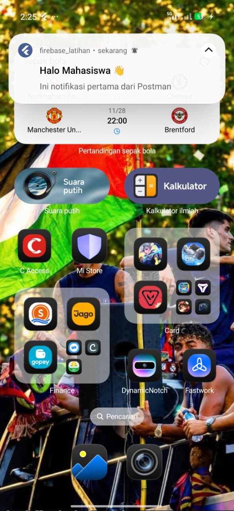

# Dokumentasi Firebase Cloud Messaging (FCM)

Dokumentasi ini berisi hasil pengujian pengiriman notifikasi menggunakan **Firebase Cloud Messaging (FCM)** melalui Postman.

## Hasil Pengujian

Pengiriman notifikasi dilakukan melalui Postman menggunakan Firebase Cloud Messaging HTTP v1 dengan tujuan perangkat Android berdasarkan FCM Token.

### 1. Screenshot Pengujian di Postman

## Kesimpulan

Berdasarkan hasil pengujian, pengiriman notifikasi ke perangkat menggunakan Firebase Cloud Messaging melalui Postman berhasil dilakukan.
